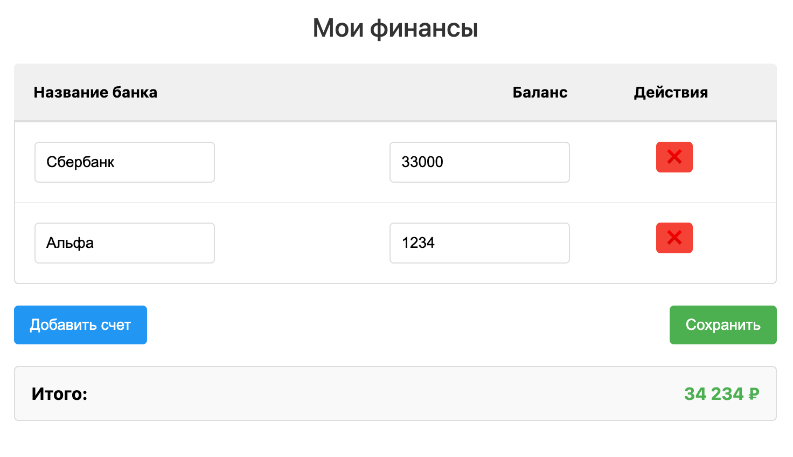

# Мои финансы (Tauri версия)

Это аналог приложения "Мои финансы", реализованный с использованием фреймворка Tauri вместо Electron/Cordova. Tauri позволяет создавать более легковесные настольные приложения с использованием веб-технологий и Rust.

## Скриншот приложения



## Преимущества Tauri перед Electron
- Значительно меньший размер приложения (в десятки раз)
- Более высокая производительность
- Использование системного WebView вместо полной установки Chromium
- Безопасность, обеспечиваемая Rust
- Доступ к нативным API через Rust

## Установка и запуск

### Требования
- [Node.js](https://nodejs.org/) (рекомендуется версия 16 или новее)
- [Rust](https://www.rust-lang.org/tools/install)
- Зависимости для Tauri (см. [официальную документацию](https://tauri.app/v1/guides/getting-started/prerequisites/))

### Установка зависимостей

```bash
# Установка Tauri CLI
npm install -g @tauri-apps/cli

# Установка зависимостей проекта
cd tauri-analog
npm install
```

### Запуск в режиме разработки

```bash
cd tauri-analog
npm run dev
```

### Сборка приложения

```bash
cd tauri-analog
npm run build
```

После сборки исполняемые файлы будут доступны в директории `src-tauri/target/release/bundle`.

## Структура проекта

- `src/` - Веб-часть приложения (HTML, CSS, JavaScript)
- `src-tauri/` - Rust код и конфигурация Tauri
  - `src/main.rs` - Главный Rust файл с бэкендом приложения
  - `tauri.conf.json` - Конфигурация Tauri
  - `Cargo.toml` - Управление зависимостями Rust

## Функциональность

Приложение позволяет:
- При первом запуске приложения автоматически создаются два демо-счета:
   - Сбербанк со случайным балансом от 50,000 до 150,000 рублей
   - Тинькофф со случайным балансом от 30,000 до 110,000 рублей
- Добавлять банковские счета
- Указывать баланс каждого счета
- Подсчитывать итоговую сумму по всем счетам
- Сохранять данные между запусками приложения
- Удалять счета

## Отличия от Cordova/Electron версии

- Вместо localStorage используется хранение в файловой системе через Rust API
- Нет необходимости в плагинах для доступа к нативным функциям
- Значительно меньший размер приложения
- Более высокая производительность

## Дорожная карта развития

- Улучшение интерфейса
